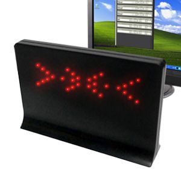
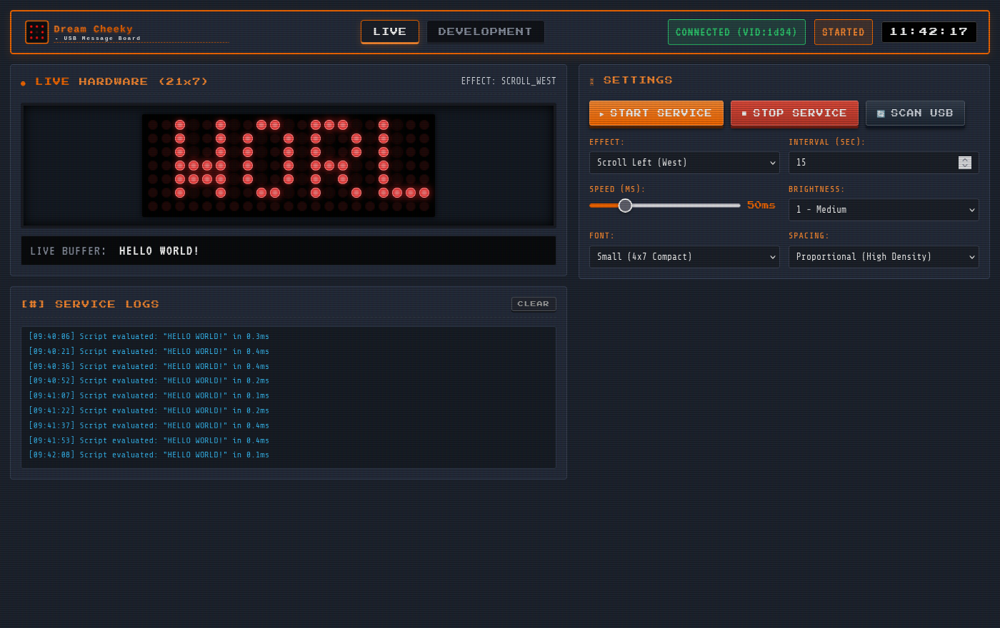
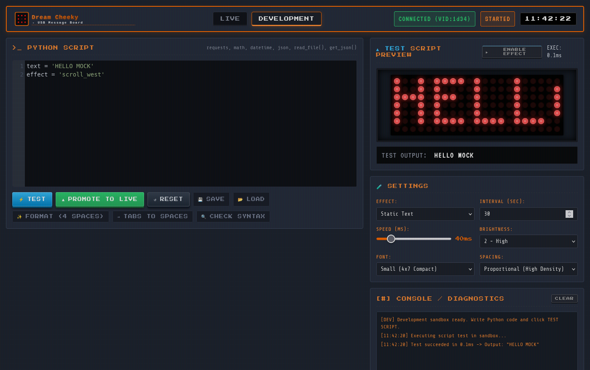

# Dream Cheeky USB LED Matrix Studio

<p align="center">
  
</p>

A modern 1980s retro-styled web controller, animation engine, and sandbox environment for the **Dream Cheeky USB LED Message Board** (Model 818 / VID: `0x1D34`, PID: `0x0013`).

---

## 📸 Screenshots

### Live Monitor Tab
Dedicated live hardware monitoring, 21×7 matrix rendering, real-time marquee feed, physical hardware settings, and service event logs.

<p align="center">
  
</p>

### Development Sandbox Tab
Integrated Python script IDE, syntax checking, 4-space auto-formatter, sandbox test preview, interactive effect player (`ENABLE EFFECT`), and local disk file save/load.

<p align="center">
  
</p>

---

## 📟 Hardware Specifications

- **Device Name**: Dream Cheeky USB LED Message Board (Model 818)
- **USB Vendor ID (VID)**: `0x1D34`
- **USB Product ID (PID)**: `0x0013`
- **Resolution**: 21 Columns × 7 Rows (147 Bright Red LEDs)
- **Protocol**: USB HID Control Transfers (5 control packets per frame)
- **Documentation**: [Official Developer Manual v1.0 (PDF)](docs/USB_LED_Message_Board_Developer_Manual_v1.0.pdf)

---

## ✨ Features

- **Dual Tab Architecture**:
  - **LIVE**: Dedicated physical hardware monitor, live 21×7 LED telemetry marquee, brightness, font selection, spacing density, and service logs.
  - **DEVELOPMENT**: Python sandbox runtime editor (`requests`, `datetime`, `math`, `json`), syntax checking, 4-space auto-formatter, local disk save/load, and real-time 21×7 matrix preview with interactive effect playback (`ENABLE EFFECT`).
- **Complete Legacy Font Engine**:
  - Extracted from `legacy/dcled-master/`:
    - `default`: 5×7 Standard X11 font
    - `small`: 4×7 Compact font
    - `sga`: Standard Galactic Alphabet
    - `small_inv`: Inverted high-contrast font
  - **Proportional vs Fixed Spacing**: Tight proportional glyph trimming squeezes strings (e.g. `"16.54"`) into the 21-column boundary statically without mandatory horizontal scrolling.
- **Visual Effects**:
  - Scrolling: Left (West), Right (East), Up (North), Down (South).
  - Flashing text with customizable pulse rate.
  - 12h/24h Digital clocks, Binary BCD clock, TV static warmup, fireplace hearth, and load tachometer.
- **Zero-Hardware Virtual Simulator**:
  - Built-in PyUSB mock device silently intercepts hardware transfers when no physical LED board is plugged in, allowing complete containerized local testing and UI preview.

---

## 🚀 Quick Start (Docker)

Start the environment with the included control script:

```bash
# Start standalone test container (includes Mock USB Device simulator)
./scripts/start.sh

# Rebuild container with latest changes and run automated verification suite
./scripts/start.sh --recreate && ./scripts/start.sh --test

# Follow runtime logs
./scripts/start.sh --logs

# Stop container
./scripts/start.sh --stop
```

Open your browser to:
**http://localhost:8080**

---

## 🐳 Docker Compose Deployment & USB Passthrough

For persistent host deployment via `docker-compose.yml`:

```yaml
services:
  dcled-studio:
    image: diepeterpan/dreamcheekyledmatrix:latest # or build from repo
    container_name: dcled-studio
    restart: unless-stopped
    ports:
      - "8080:8080"
    volumes:
      - /opt/dreamcheeky/config.json:/app/config.json
      # Pass through USB device tree so container can claim Dream Cheeky hardware
      - /dev/bus/usb:/dev/bus/usb
    privileged: true
    environment:
      - PYTHONUNBUFFERED=1
      - DCLED_CONFIG=/app/config.json
```

> [!IMPORTANT]
> **Host File Mount Notice**:
> If mounting `/opt/dreamcheeky/config.json`, make sure the file exists on the host **before** running `docker compose up`. If the file does not exist, Docker will automatically create `/opt/dreamcheeky/config.json` as a directory on the host, causing an `[Errno 21] Is a directory` error.
>
> Prepare the host path first:
> ```bash
> sudo mkdir -p /opt/dreamcheeky
> echo "{}" | sudo tee /opt/dreamcheeky/config.json
> ```
> *(Note: The application includes internal fallback detection that gracefully stores the configuration within the mounted directory if Docker created one).*

---

## 📁 Repository Structure

```
├── backend/                  # FastAPI backend, effects engine, font loader & service daemon
│   ├── driver.py             # PyUSB hardware driver (VID 0x1D34, PID 0x0013)
│   ├── effects.py            # Text renderers, scroll generators & flashing effects
│   ├── font.py               # DLF font parser & glyph proportional trimmer
│   ├── main.py               # REST API & WebSocket telemetry server
│   ├── script_engine.py      # Python AST validator, sandbox runner & code formatter
│   └── service.py            # Background physical USB & matrix render thread
├── docs/                     # Developer manual & hardware assets
│   ├── dream_cheeky_led_message_board.jpg
│   └── USB_LED_Message_Board_Developer_Manual_v1.0.pdf
├── fonts/                    # .dlf font definitions (default, small, sga, small_inv)
├── frontend/                 # index.html UI
├── scripts/                  # start.sh, mock_device.py, test_endpoints.py
├── static/                   # CSS styling, app.js, favicons, product image
└── config.json               # Persisted user & developer configuration
```

